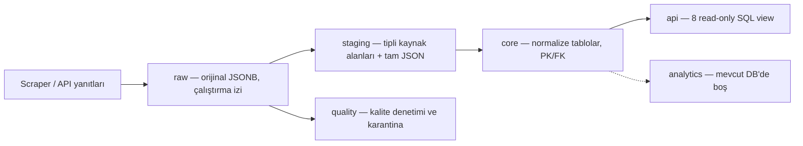
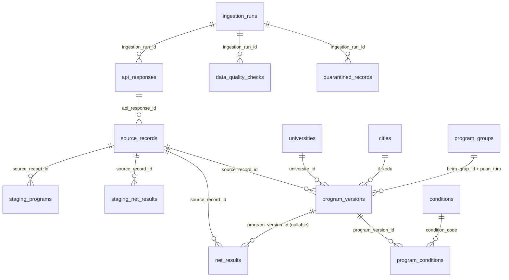

# YÖK Atlas Intelligence — PostgreSQL Veritabanı Referansı

**Hedef kitle:** Backend geliştiricisi, frontend geliştiricisi, analitik geliştiricisi ve sistem operatörü.  
**Belge türü:** Çalışan DB'nin açıklaması + operasyon runbook'u; migration değildir.  
**Kaynak:** 10 Ekim 2026 tarihinde paylaşılan `current_schema.sql` (PostgreSQL 17.11) ve son salt-okunur DB audit çıktısı.  
**Kritik not:** Sayılar tarihsel snapshot'tır, otomatik güncellenmez. Canlı ortamda doğrulamak için aşağıdaki sorguları çalıştırın.

## 1. En kısa özet

Bu veri tabanı, YÖK Atlas kamuya açık API'sinden alınan JSON'u 4 veri katmanında yönetir:



- **6 PostgreSQL şeması:** `raw`, `staging`, `core`, `quality`, `api`, `analytics`.
- **17 fiziksel tablo:** raw 3, staging 5, core 7, quality 2. **8 API view**, analytics'te henüz nesne yok.
- **Kullanım:** Backend tercihen `api.*` view'larını okur; frontend doğrudan PostgreSQL'e bağlanmaz. Scraper yalnızca `raw.*` yazar. ETL `staging.*` ve `core.*` yönetir.
- **Ham içerik:** API yanıtı ve kayıtları `JSONB`; alan/değer düzeyinde korunur, fakat özgün HTTP response baytları, anahtar sırası ve boşluklar **birebir korunmaz**.
- **Tamlık iddiası:** Bu şema **keşfedilmiş 5 endpoint / 5 kaynak varlığını** kapsar. YÖK Atlas'ın bütün olası API'leri tarandı anlamına gelmez.

## 2. Ortam ve bağlantı

| Ayar | Yerel geliştirme değeri |
|---|---|
| DB | `yokatlas_intelligence` |
| PostgreSQL | 17 (audit dökümü: 17.11) |
| Docker konteyneri | `yokatlas-intelligence-postgres-1` |
| Host erişimi | `127.0.0.1:5433` |
| PostgreSQL container iç portu | `5432` |
| Çalışan yönetici rolü | `atlas_owner` |
| Öngörülen uygulama rolleri | `atlas_ingest`, `atlas_api`, `atlas_analytics` (varlık ve GRANT yetkilerini **ayrıca doğrula**) |

**Parolaları repo, doküman veya commit içine koymayın.** Ortama göre `.env` / secret manager kullanın. n8n için ayrıca başka PostgreSQL container'ı ve hostta **5432** portu var; yanlış DB'ye bağlanmayın.

Windows PowerShell:

```powershell
docker exec -it yokatlas-intelligence-postgres-1 `
  psql -U atlas_owner -d yokatlas_intelligence
```

Container dışındaki servis için örnek değişkenler:

```dotenv
DB_HOST=127.0.0.1
DB_PORT=5433
DB_NAME=yokatlas_intelligence
DB_USER=atlas_api
DB_PASSWORD=<SECRET_FROM_ENV>
```

> Not: Container'dan container'a `127.0.0.1` hedef DB değildir. Ortak Docker ağı ve servis adı kullanın; ağları doğrulayın. PgAdmin container'ından host mapping için `host.docker.internal:5433` kullanılabilir.

## 3. Katmanlar ve tablo kataloğu

### RAW: toplama ve kaynak geçmişi

| Tablo | PK | Esas alanlar | İşlev |
|---|---|---|---|
| `raw.ingestion_runs` | `ingestion_run_id` | `source_system`, `started_at`, `completed_at`, `status`, `scraper_version`, `details JSONB` | Her scraper/ingestion çalışması |
| `raw.api_responses` | `api_response_id` | `ingestion_run_id FK`, `endpoint`, `method`, `score_type`, `page_number`, `captured_at`, `source_hash_sha256`, `http_status`, `payload JSONB`, `source_path` | Tam parse edilmiş API yanıtı |
| `raw.source_records` | `source_record_id` | `api_response_id FK`, `source_entity`, `source_array_index`, `record JSONB`, `record_hash_sha256` | Response içindeki bireysel kayıtlar |

Özel UNIQUE: `raw.source_records(api_response_id, source_entity, source_array_index)`; ayrıca `raw.api_responses` üzerinde `endpoint, coalesce(score_type,''), coalesce(page_number,-1), source_hash_sha256` için **kısmi unique index** var (`source_hash_sha256 IS NOT NULL`). **Run ID ve istek gövdesi bu unique indexte bulunmaz.** Tekrar tarama ve filtrelerin ayırt edilmesi için bu sınıra dikkat edin. Ayrıntılı scraper sözleşmesi: `SCRAPER_POSTGRES_INTEGRATION_GUIDE.md`.

### STAGING: tipli fakat kaynak odaklı

| Tablo | PK | Önemli özellik |
|---|---|---|
| `staging.universities` | `staging_id` | `source_record_id UNIQUE FK`, `source_payload JSONB` |
| `staging.cities` | `staging_id` | `source_record_id UNIQUE FK`, `source_payload JSONB` |
| `staging.program_groups` | `staging_id` | `birim_grup_id`, `puan_turu`, `source_record_id UNIQUE FK`, `source_payload JSONB` |
| `staging.programs` | `staging_id` | Program JSON'unun geniş tipli kolon seti; `source_record_id UNIQUE FK`, `source_payload JSONB` |
| `staging.net_results` | `staging_id` | Net kolonları, yıl ve kimlikler; `source_record_id UNIQUE FK`, `source_payload JSONB` |

**Dikkat:** Gerçek JSON saklama kolonu `payload` **değil** `source_payload`'dır. Tüm `source_record_id` bağlantıları RAW'a uzanır. STAGING'de aynı doğal anahtarın tekrar etmesi mümkündür ve bu tek başına hata değildir.

### CORE: ilişkisel model

| Tablo | PK / UNIQUE | İlişkiler / kullanım |
|---|---|---|
| `core.universities` | PK `universite_id` | Üniversite kimliği ve adı; opsiyonel `source_record_id FK` |
| `core.cities` | PK `il_kodu` | İl kodu/adı; opsiyonel `source_record_id FK` |
| `core.program_groups` | **Bileşik PK** `(birim_grup_id, puan_turu)` | Program grubu ve puan türü; grup ID'si tek başına benzersiz varsayılmamalı |
| `core.program_versions` | PK `program_version_id`; UNIQUE `(kilavuz_kodu, yil)` | Yıllık program kaydı; üniversite, şehir, grup FK'leri |
| `core.net_results` | PK `net_result_id`; UNIQUE `(kilavuz_kodu, yil, puan_turu)` | Net/puan sonuçları; `program_version_id` **nullable FK** |
| `core.conditions` | PK `condition_code` | Koşul açıklaması + `raw_details JSONB` |
| `core.program_conditions` | Bileşik PK `(program_version_id, condition_code)` | Program/koşul N:N köprüsü |

`core.program_versions` kritik alanlar: `program_version_id`, `kilavuz_kodu`, `yil`, `universite_id`, `il_kodu`, `birim_grup_id`, `puan_turu`, `birim_id`, `birim_adi`, `fymk_id`, `min_puan`, `basari_sirasi`, `kontenjan`, `source_record_id`, `remaining_fields JSONB`, `ingested_at`.

`core.net_results` kritik alanlar: `net_result_id`, `kilavuz_kodu`, `yil`, `puan_turu`, `program_version_id`, `universite_id`, `birim_grup_id`, `taban_puan`, `katsayi`, `obp`, TYT (`tyt_trk_net`, `tyt_sos_net`, `tyt_mat_net`, `tyt_fen_net`), AYT (`ayt_mat_net`, `ayt_fiz_net`, `ayt_kim_net`, `ayt_bio_net`, `ayt_tde_net`, `ayt_trh1_net`, `ayt_cog1_net`, `ayt_trh2_net`, `ayt_cog2_net`, `ayt_fel_net`, `ayt_din_net`), `ydt_ydil_net`, `source_record_id`, `remaining_fields JSONB`, `ingested_at`.

**Tarihsel eşleştirme uyarısı:** Program kataloğu şu anda **2026**, netler **2023–2025** yılları için dolu. `core.net_results.program_version_id` mevcut 62.992 net satırının **tamamında NULL**. Netleri sırf `kilavuz_kodu` aynı diye 2026 program sürümüne iliştirmeyin. `core.net_results.universite_id` fiziksel şemada FK değildir; audit'te **278** net satırındaki üniversite ID'sinin mevcut lookup'ta karşılığı bulunmadı.

### QUALITY

- `quality.data_quality_checks`: `check_id PK`, opsiyonel `ingestion_run_id FK`, `check_name`, `status`, `observed_value JSONB`, `executed_at`.
- `quality.quarantined_records`: `quarantine_id PK`, opsiyonel `ingestion_run_id FK`, `entity`, `reason`, `natural_key JSONB`, `source_record_ids JSONB`, `candidate_payloads JSONB`, `created_at`, `resolved_at`, `resolution`.
- Denetim anında karantina satırı **0** idi. Bu sayı “tüm veri testleri çalıştırıldı ve kusursuz” anlamına gelmez.

### API: backend için mevcut 8 VIEW

| View | Temel çıktı / önemli not |
|---|---|
| `api.universities` | `universite_id`, `universite_adi` |
| `api.cities` | `il_kodu`, `il_adi` |
| `api.program_groups` | `(birim_grup_id, puan_turu, birim_grup_adi)` |
| `api.program_catalog` | Program + üniversite + grup + il adı, `min_puan`, `basari_sirasi`, `kontenjan` |
| `api.net_results` | Yıllık net kolonları; program ve üniversite adlarıyla zenginleştirilmiş **değildir** |
| `api.program_year_summary` | `(yil, puan_turu)` bazında `programs`, `with_min_puan`, `avg_min_puan`, `total_kontenjan` |
| `api.net_year_summary` | `(yil, puan_turu)` bazında `net_records`, `avg_tyt_mat_net`, `avg_tyt_trk_net`, `avg_obp` |
| `api.data_coverage` | `universities`, `cities`, `program_groups`, `program_versions`, `net_results` için row count |

`api.program_catalog`, `core.program_versions` ile `core.universities` arasında **INNER JOIN**; grup ve il ile **LEFT JOIN** yapar. Yani veri kalitesi sorunu yaşanırsa üniversite eşleşmeyen program görünümden düşebilir (mevcut audit'te 2026 programları için eksik eşleşme 0). `api.program_year_summary` içindeki `avg_min_puan` **basit aritmetik ortalamadır**, öğrenci/kontenjan ağırlıklı değildir. `total_kontenjan` da **yerleşen öğrenci** sayısı değildir.

## 4. ER ilişkileri (mantıksal özet)

Aşağıdaki bağlantılar fiziksel FK'lere dayanır (API view okları veri türetimini gösterir, FK değildir):



Kısa gösterim için tablolardaki `raw/core/quality` önekleri ER kodunda kaldırıldı; gerçek SQL'de daima schema önekini kullanın.

## 5. Denetim anındaki kayıt sayıları ve kalite sonuçları

| Nesne | Kayıt |
|---|---:|
| `raw.api_responses` | 852 |
| `raw.source_records` | 85.476 |
| `staging.universities` / `core.universities` | 228 / 228 |
| `staging.cities` / `core.cities` | 83 / 83 |
| `staging.program_groups` / `core.program_groups` | 611 / 611 |
| `staging.programs` / `core.program_versions` | 21.491 / 21.491 |
| `staging.net_results` / `core.net_results` | 63.063 / 62.992 |
| `core.conditions` | 194 |
| `core.program_conditions` | 50.432 |
| `quality.quarantined_records` | 0 |

- Netlerde `(kilavuz_kodu,yil,puan_turu)` bazında **71 fazla kayıt** var; yinelenen anahtar gruplarında **farklı payload 0**. Bu fark kaynak düzeyinde birebir tekrarlarla açıklanabiliyor.
- 21.491 programda üniversite/il/grup/source eksik eşleşmesi **0**.
- `staging.programs` ve `staging.net_results` JSON payload'ları ile bağlı RAW kayıtların JSON'ları arasında test edilen tüm kayıtlarda **0 fark**.
- Yıl kapsamı: programlar **2026 (21.491)**; netler **2023 (21.342)**, **2024 (20.900)**, **2025 (20.821)** staging satırı.
- Önceki audit'in “kaynak JSON'da olup typed staging'de olmayan alanlar” raporu camelCase↔snake_case adları doğrudan kıyasladığı için **gerçek kayıp alan listesi değildir**. Alan bazlı dönüşüm doğruluğu henüz ayrıca incelenmeli.

## 6. Backend geliştiricisi: okuma sözleşmesi ve örnek SQL

**Temel kural:** Backend kullanıcılarına veritabanına direkt erişim açılmasın. Uygulama sunucusu **sadece gerekli SELECT** yetkisine sahip rol ile bağlansın; uygun olduğunda `api.*` view'larını kullanın. SQL parametrize edilmeli, sorgular sayfalanmalı, sıralama whitelist ile sınırlanmalı ve makul timeout konulmalı.

### Üniversiteleri listele

```sql
SELECT universite_id, universite_adi
FROM api.universities
ORDER BY universite_adi
LIMIT $1 OFFSET $2;
```

### Program arama — yıl, puan türü, üniversite

```sql
SELECT program_version_id, kilavuz_kodu, yil, universite_id,
       universite_adi, birim_adi, birim_grup_id, birim_grup_adi,
       il_kodu, il_adi, puan_turu, kontenjan, min_puan, basari_sirasi
FROM api.program_catalog
WHERE yil = $1
  AND ($2::text IS NULL OR puan_turu = $2)
  AND ($3::bigint IS NULL OR universite_id = $3)
ORDER BY basari_sirasi ASC NULLS LAST, kilavuz_kodu
LIMIT $4 OFFSET $5;
```

> `$1` parametre gösterimidir; tercih edilen uygulama sürücüsünde placeholder biçimi farklı olabilir. `LIMIT` ve `OFFSET` güvenilir şekilde sınırlandırılmalıdır. Production'da filtreye uygun indeks, keyset pagination veya iki aşamalı sorgu gerekebilir.

### Program detay ve koşulları

```sql
SELECT p.program_version_id, p.kilavuz_kodu, p.yil, p.birim_adi,
       p.kontenjan, p.min_puan, p.basari_sirasi,
       c.condition_code, c.description
FROM core.program_versions p
LEFT JOIN core.program_conditions pc
  ON pc.program_version_id = p.program_version_id
LEFT JOIN core.conditions c
  ON c.condition_code = pc.condition_code
WHERE p.kilavuz_kodu = $1 AND p.yil = $2
ORDER BY c.condition_code;
```

Bu sorgu **her koşul için bir satır** döndürebilir; backend response'da koşulları diziye gruplayın. `api.program_catalog` içinde koşul ve detay JSON'u henüz yok; backend'e direkt `core` SELECT yetkisi verilmeden önce kontrollü yeni API view açmak daha iyi olabilir.

### Yıl bazında kapsama ve istatistik

```sql
SELECT * FROM api.data_coverage ORDER BY entity;
SELECT * FROM api.program_year_summary ORDER BY yil DESC, puan_turu;
SELECT * FROM api.net_year_summary ORDER BY yil DESC, puan_turu;
```

### Tarihsel net sonuçları

```sql
SELECT kilavuz_kodu, yil, puan_turu, taban_puan, obp,
       tyt_trk_net, tyt_mat_net, tyt_sos_net, tyt_fen_net,
       ayt_mat_net, ayt_fiz_net, ayt_kim_net, ayt_bio_net, ydt_ydil_net
FROM api.net_results
WHERE yil = $1 AND puan_turu = $2
ORDER BY kilavuz_kodu
LIMIT $3 OFFSET $4;
```

**Veri anlamları:** Net sonuçları “yerleşen son kişinin netleri” bağlamında kullanılabilir; kaynağın ölçüm tanımını doğrulamadan tüm yerleşenlerin ortalaması olarak sunmayın. `basari_sirasi`, `taban_puan`, `min_puan` alanlarını rastgele birbirinin yerine kullanmayın. `0` ile `NULL` farklıdır. Eski kaynakta `minPuan1/2/3` gibi suffix alanların hangi yıllara karşılık geldiği **doğrulanmadı**.

### Önerilen HTTP servis sınırları (uygulanmış endpoint değil)

`GET /universities`, `GET /programs?year=2026&scoreType=SAY`, `GET /programs/{code}?year=2026`, `GET /programs/{code}/conditions?year=2026`, `GET /nets?year=2025&scoreType=SAY`, `GET /coverage`. Bunlar **tasarım önerileridir**; bu adlarla çalışan backend API'si bulunduğu iddia edilmez.

## 7. Frontend geliştiricisi: ne gösterilebilir, ne gösterilemez?

### Şu an doğrudan veri kaynağı olan ekranlar

- Üniversite arama/seçim (`api.universities`)
- Program katalog arama ve filtreleme (yıl, puan türü, üniversite, il, kontenjan, başarı sırası vb.; `api.program_catalog`)
- Program yıllık kontenjan ve giriş puanları (`api.program_catalog`)
- Program koşulları (backend kontrollü `core.program_conditions` + `core.conditions`)
- Geçmiş netleri ve özetler (`api.net_results`, `api.net_year_summary`)
- Veri kapsam ekranı (`api.data_coverage`)

### Şu an **hazırmış gibi gösterilmeyecek** analizler

- Yerleşen sayısı, **doluluk oranı**, ek yerleşme, ilk kayıt/gerçekleşen kayıt, kayıt dönüşümü.
- Öğrenci tercih sırası, il/lise dağılımı, cinsiyet profili.
- Gerçek tahsilat, net gelir, işletme maliyeti.
- Güvenilir program bazında 2023–2026 trend: 2023–2025 net kayıtlarına karşılık gelen yıllık program sürümleri henüz yok.
- İleri tahmin / risk / rekabet / analitik skor: `analytics` şemasında doğrulanmış bir model henüz yok.

**Frontend veri tipi kuralları:** Sayısal `NULL` değerini `0`'a dönüştürme; UI'da `Veri yok` olarak göster. Yıl bilgisini tüm kıyas ve grafikte göster. `min_puan`, `basari_sirasi`, `kontenjan` değerlerinin ölçek/birimleri doğru etiketlenmeli. Backend response nullability'sine uyun. Kullanıcıya veritabanı kimliklerini değil görünür metinleri sunun; ancak program derin bağlantısında `kilavuz_kodu` ve `yil` ikilisini koruyun. Sayısal BIGINT değerleri JavaScript `Number` güvenli tam sayı sınırını aşarsa backend `string` serileştirmesi kullanmalıdır.

## 8. Operatör runbook'u: sık kullanılan işlemler

### Bağlan, tabloları ve view'ları gör

```powershell
docker ps --filter "name=yokatlas-intelligence-postgres-1"
docker exec -it yokatlas-intelligence-postgres-1 `
  psql -U atlas_owner -d yokatlas_intelligence
```

`psql` içinde:

```text
\dn
\dt raw.*
\dt staging.*
\dt core.*
\dt quality.*
\dv api.*
\d+ core.program_versions
\d+ core.net_results
\q
```

### Kapsam ve run sağlığı

```sql
SELECT * FROM api.data_coverage ORDER BY entity;
SELECT yil, COUNT(*) FROM core.program_versions GROUP BY yil ORDER BY yil;
SELECT yil, COUNT(*) FROM core.net_results GROUP BY yil ORDER BY yil;
SELECT status, COUNT(*) FROM raw.ingestion_runs GROUP BY status;
SELECT ingestion_run_id, started_at, completed_at, status, scraper_version, details
FROM raw.ingestion_runs ORDER BY ingestion_run_id DESC LIMIT 20;
SELECT endpoint, method, COUNT(*) FROM raw.api_responses
GROUP BY endpoint, method ORDER BY endpoint;
SELECT source_entity, COUNT(*) FROM raw.source_records
GROUP BY source_entity ORDER BY source_entity;
SELECT COUNT(*) AS open_quarantines FROM quality.quarantined_records
WHERE resolved_at IS NULL;
```

### Duplicates ve bağlanabilirlik

```sql
SELECT COUNT(*) AS total_rows,
       COUNT(DISTINCT (kilavuz_kodu, yil, puan_turu)) AS distinct_keys,
       COUNT(*) - COUNT(DISTINCT (kilavuz_kodu, yil, puan_turu)) AS extra_rows
FROM staging.net_results;

SELECT COUNT(*) FILTER (WHERE program_version_id IS NULL) AS unlinked,
       COUNT(*) AS total FROM core.net_results;

SELECT COUNT(*) AS net_unknown_university
FROM core.net_results n
LEFT JOIN core.universities u ON u.universite_id = n.universite_id
WHERE n.universite_id IS NOT NULL AND u.universite_id IS NULL;
```

### Güvenli şema dışa aktarımı

PowerShell terminalinde (`psql` içinde değil):

```powershell
docker exec yokatlas-intelligence-postgres-1 `
  pg_dump -U atlas_owner -d yokatlas_intelligence `
  --schema-only --no-owner --no-privileges `
  -f /tmp/current_schema.sql

docker cp yokatlas-intelligence-postgres-1:/tmp/current_schema.sql `
  .\current_schema.sql
```

**Veri yedeği ayrı bir iştir:** `--schema-only` kayıtları yedeklemez. Veri dahil custom dump örneği:

```powershell
docker exec yokatlas-intelligence-postgres-1 `
  pg_dump -U atlas_owner -d yokatlas_intelligence `
  --format=custom --no-owner --no-privileges `
  -f /tmp/yokatlas_backup.dump

docker cp yokatlas-intelligence-postgres-1:/tmp/yokatlas_backup.dump `
  .\yokatlas_backup.dump
```

Bu komut veri tabanını değiştirmez, ancak yedek dosyasının disk alanını tüketir. **Yedeklerde hassas bilgiler bulunabilir; repoya commit etmeyin.** Geri yükleme (*restore*) veri değiştirebilen bir işlemdir: önce ayrı test DB'sinde deneyin; üretim DB'sine körlemesine uygulamayın.

### Şema değişikliği / migration protokolü

1. Değişiklik ihtiyacını `current_schema.sql`, audit ve kaynak alan semantiğiyle doğrula.
2. `raw` verilerini koru; geçmişi etkileyen dönüşümlerde idempotent ETL/backfill planını yaz.
3. Migration sürümlü ve code-review'lu olsun; uygulama sürümü / DB sürümünü birlikte takip et.
4. Önce yedek al; staging/test DB'de migration + rollback değerlendirmesi yap.
5. `api.*` view değişikliklerinde backend contract ve frontend tiplerini güncelle.
6. İş bittikten sonra veri kalite sorgularını ve örnek API sorgularını tekrar çalıştır.
7. **DB sahipliği/yetki (roles) detayları `--no-privileges` dump'ta görünmez**; ayrı `\du`, `\dp schema.table` ve migration dosyalarıyla doğrula.

### pgAdmin ERD

Mevcut pgAdmin web arayüzü konteyneri `n8n-pgadmin-1`; yerel erişim tipik `http://127.0.0.1:5050`. PostgreSQL sunucusunu `host.docker.internal:5433`, DB `yokatlas_intelligence`, kullanıcı `atlas_owner` ile tanımlayabilirsiniz (DB parolası ile pgAdmin giriş parolası farklıdır). `core` şemasına sağ tık → *ERD for Schema* veya ERD Tool → Add Table. Diyagram, tablodaki FK ilişkilerini gösterir; `api` VIEW bağlantılarını otomatik FK gibi göstermez.

## 9. Bilinen açıklar / backlog (kanıt ile varsayımı ayırın)

| Öncelik | Konu | Durum |
|---|---|---|
| P0 | 5 keşfedilmiş endpoint dışındaki kamuya açık kaynaklar | Tam API keşfi kanıtlanmadı |
| P0 | Tarihsel program versiyonları ve net bağlantıları | Programlar 2026, netler 2023–25; tüm net `program_version_id` NULL |
| P0 | CORE dönüşüm değer doğruluğu ve alan sözlüğü | RAW↔STAGING JSON eşit; tipli kolonlarla tam semantik eşitlik ayrıca kanıtlanmadı |
| P1 | Aynı yanıtın farklı run'lardaki gözlemi | Unique index tekrar yazımı kısıtlıyor; gözlem geçmişi için ek tasarım gerekebilir |
| P1 | HTTP request filtreleri / JSON dışı dosya bayt arşivi | Mevcut RAW şemasında yapılandırılmış request payload ve byte-exact dosya deposu yok |
| P1 | Ücret, burs, dil, akreditasyon ve alt kontenjanları doğrudan API'den servis etmek | Staging geniş, CORE önemli alanları `remaining_fields` içinde saklayabilir; mevcut API view'ları bunları dışarı açmıyor |
| P1 | 278 net kaydındaki eksik üniversite lookup'u | Tarihsel kaynak kimlikleri araştırılmalı; ham satırlar silinmemeli |
| P2 | Kurum içi ücret/kayıt/gelir ve başka Atlas istatistikleri | Mevcut 5 API kaynağında ayrı core tabloları yok; yeni veri kaynağı kanıtlanmadan model türetilmemeli |
| P2 | Analitik fact/view ve tahmin motoru | `analytics` şeması şu an boş |

**Oluşturulmayan tabloyu varmış gibi kullanmayın.** Yeni feature önerilerinde: veri kaynağı → API JSON anahtarı → staging dönüştürme → core ilişki → api view → backend response → frontend temsil zincirini belgeleyin.

## 10. Projeye katılan geliştiriciler için görev talimatı

**Backend geliştiricisi:** Önce bölüm 3–6'yı oku. DB'yi SQL migration olmadan değiştirme. `api.*` view'larını kullanan parametreli, sayfalı uçlar tasarla. Tarihsel program-net join'i oluşturma. Dokümantasyon/şema doğrulaması için `current_schema.sql`'i esas al. API response tiplerini alan ve nullability temelli tanımla.

**Frontend geliştiricisi:** Bölüm 7'deki doğrulanmış ekranlarla başla. Her grafik için yıl, veri kapsamı ve null durumunu göster. Backend API sözleşmesi çıkmadan veritabanı kolonlarından doğrudan client network çağrısı tasarlama. Yerleşme/doluluk/gelir göstergeleri için uydurma değer üretme.

**Operatör / proje sahibi:** Bölüm 8'deki komutlarla bağlantı, kapsam, başarısız ingestion, karantina ve yedek durumunu izle. DB şeması veya veri kümesi değiştikten sonra belgeyi ve örnek sorguları güncelle. Kayıt sayısını değil kalite/freshness/lineage metriklerini birlikte takip et.

---

## Referans dosyaları

- `current_schema.sql` — canlı PostgreSQL 17.11 fiziksel DDL (tablo, view, PK/FK, index).
- `Yapıştırılan metin.txt` — salt okunur DB audit çıktısı (kayıt, anahtar, tutarlılık ve yıllar).
- `SCRAPER_POSTGRES_INTEGRATION_GUIDE.md` — scraper ekibi için RAW yazma sözleşmesi.
- `normalized_schema.json` — YÖK Atlas API örneklerinden çıkarılmış **mantıksal** alan envanteri; fiziksel PostgreSQL DDL değildir.

> **Güncelleme ilkesi:** Bu dosya çalışan DB'nin belirli tarihteki belgesidir. Yeni migration, endpoint, ETL sürümü veya yük sonrası `pg_dump --schema-only` ve audit raporlarını yenileyip farklılıkları kontrol edin.
