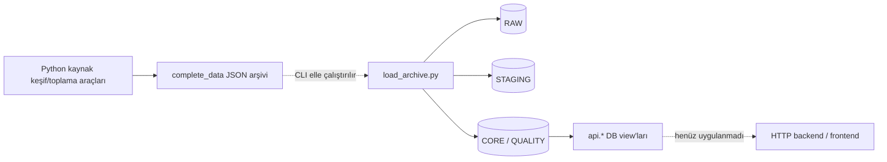

# Backend / platform — Faz 0 mevcut durum raporu

**Tarih:** 13 Ekim 2026, Europe/Istanbul.

**Durum:** Keşif tamamlandı; mimari/API tasarımı ve uygulama için aşama onayı bekleniyor.

**Kapsam:** Bu checkout, yerel PostgreSQL ve açık iki taslak PR'nin ilgili arayüz belgeleri.

Yerel PostgreSQL ve veri sözleşmesi çalışıyor. İncelenen `main` tabanlı checkout'ta
HTTP backend, servis kimliği/RBAC katmanı, ETL job orkestrasyonu, frontend
uygulaması veya CI bulunmuyor. Mevcut Python araçları arşiv üretme, alan/anahtar
analizi ve elle çalıştırılan RAW/STAGING/CORE yüklemesini sağlıyor.

Bu aşamada uygulama kodu, migration, DB şeması, grants veya kaynak veriler
değiştirilmedi. Rapor, tekrar çalıştırılabilir salt okunur SQL kontrolleri ve
metadata kanıtı oluşturuldu. Önceki kurulum raporundaki parola doğrulaması
gerçek SCRAM bağlantısıyla düzeltilerek yeniden doğrulandı.

## 1. Kaynaklar ve doğrulama sınırı

Kanıt sırası: canlı DB metadata/DDL dökümü → migration ve kod → testler → belgeler.

| Kaynak | Kullanım |
|---|---|
| Yerel `pg_catalog` / `information_schema` | Nesneler, grants, kısıtlar, HBA ve runtime ayarları |
| `pg_dump --schema-only --no-owner --no-privileges` | Canlı şemayı repo snapshot'ı ile karşılaştırma |
| [`CURRENT_STATE_CHECKS.sql`](CURRENT_STATE_CHECKS.sql) | `BEGIN READ ONLY` içinde tekrar çalıştırılabilen metadata/kayıt sayısı kontrolleri |
| [JSON kanıtı](evidence/2026-10-13_current_state.json) | 17 tablo için kayıt sayıları, roller, grants, ayarlar ve DDL karşılaştırması |
| [`current_schema.sql`](../../current_schema.sql) | Repo şema snapshot'ı |
| [`database/migrations`](../../database/migrations) | `000`–`004` bootstrap/migration tanımları |
| [`YOKATLAS_DATABASE_REFERENCE.md`](../YOKATLAS_DATABASE_REFERENCE.md) | Veri anlamı ve önceki ortamın tarihsel audit'i |
| [`SCRAPER_POSTGRES_INTEGRATION_GUIDE.md`](../SCRAPER_POSTGRES_INTEGRATION_GUIDE.md) | RAW kabul, hash ve replay beklentileri |
| [`LOCAL_POSTGRES_SETUP_TR.md`](LOCAL_POSTGRES_SETUP_TR.md) | Bu makinenin kurulum ve test kaydı |
| Kullanıcının verdiği `BACKEND_INFRASTRUCTURE_DEVELOPER_BRIEF_TR.md` | Backend görev kapsamı; repo dışında. Dosya SHA-256'sı JSON kanıtında |

Önceki belgelerdeki 21.491 program, 62.992 CORE net, 852 yanıt, 278 eşleşmeyen
üniversite gibi sayılar başka ortamın snapshot'ıdır. Yerel DB'de veri yoktur;
bu sayılar veya veri kalitesi sonuçları burada yeniden doğrulanmış değildir.
Kaynak sitelerine istek yapılmadı ve hiçbir arşiv import edilmedi.

## 2. Git ve ekip bağımlılıkları

| Konu | Doğrulanan durum |
|---|---|
| Remote | `https://github.com/thrustec/yokatlas-intelligence.git` |
| İncelenen `origin/main` | `0d09f20804f0efb1ac1d64c63f3c9f9ef96dc1b7` |
| Aktif branch | `feat/backend-local-postgres-20261013` |
| Faz başlangıcındaki HEAD | `e815290` — yerel PostgreSQL kurulumu |
| Başlangıç çalışma ağacı | Temiz; `origin/main`den 1 commit ileride, geride değil |
| Repo/üst dizinde `AGENTS.md` | Bulunmadı |
| Bu backend branch'i için remote teslim | Henüz push/PR yapılmadı |

13 Ekim 2026'da salt okunur incelenen entegrasyon bağımlılıkları:

| Taslak PR | İncelenen head | Backend için anlamı |
|---|---|---|
| [#1 — Add reusable YÖK Atlas scraper foundation](https://github.com/thrustec/yokatlas-intelligence/pull/1) | `yokatlas-scraper-foundation`, `e4892a0` | Ortak HTTP/archive helpers; `complete_data` düzeni ve `collection_manifest.json` öneriyor. Orijinal yanıt byte hash'i, istek payload'ı, zaman ve boyut bilgileri aktarım sözleşmesinde korunmalı |
| [#2 — Research external sources for RAW ingestion decisions](https://github.com/thrustec/yokatlas-intelligence/pull/2) | `external-source-research`, `45e28a6` | Dış kaynak araştırması ve karar tablosu; tüm owner kararları `PENDING`. Fiziksel RAW tabloları bu PR'de oluşturulmuyor |

Diğer branch'lere geçilmedi, dosyaları yerel checkout'a alınmadı ve PR'ler
birleştirilmedi. Bu PR'lerdeki davranışlar burada çalıştırılıp kabul testinden
geçirilmiş sayılmaz. `build_external_sources_schema` branch'i incelenen anda
`main` ile aynı commit'teydi.

`docs/external_source_schema_inventory.md` incelenen `main` içinde yok.
Kaynak envanterinin yeni taslak konumu PR #2'de
`docs/external-sources/research/source_matrix.md` olarak bulunuyor. Backend
tasarımı kaynak bağımsız ilerleyebilir; kaynak alanları/kimlikleri ve hangi
kaynağın alınacağı bu raporla karara bağlanmaz.

## 3. Repo ve servis envanteri

| Bileşen / dosya | Mevcut işlev | Sınır |
|---|---|---|
| `backend/`, `frontend/`, `analytics/`, `shared/` | Yalnız `.gitkeep` | Çalışan uygulama/modül yok |
| [`compose.yaml`](../../compose.yaml) | PostgreSQL 17, healthcheck, localhost portu, bootstrap mount'ları | HTTP servis/worker/queue yok |
| [`compose.local.yaml`](../../compose.local.yaml) | E: veri bind mount'u | Yerel `.env` ile seçiliyor |
| `scraper/yokatlas_api_explorer/yokatlas_discovery.py` | Bilinen kaynak API'lerine Python/requests ile keşif | Backend endpoint'i veya DB writer değil |
| `scraper/yokatlas_api_explorer/yokatlas_full_validator.py` | Kaynak JSON toplama; alan, yıl ve ilişki analizi | Koleksiyon ve analiz aracı |
| `scraper/yokatlas_api_explorer/yokatlas_key_forensics.py` | Arşiv anahtar, duplicate ve referans analizi | Offline araştırma |
| `scraper/.../yokatlas_schema_starter/` | Örnek alan modeli/SQLite şeması üretimi | PostgreSQL migration kaynağı değil |
| [`load_archive.py`](../../scripts/database/load_archive.py) | Offline JSON → RAW → STAGING → CORE + QUALITY | Tek CLI, aynı DB hesabı ve dosya transaction'ı içinde ingestion ve ETL birlikte |
| `scripts/database/setup.ps1` | Yerel `.env` ve rastgele parolalar | Credential rotation yapmıyor |
| `scripts/database/apply-migrations.ps1` | `001`–`004` dosyalarını sırayla uygular | Migration version/checksum ledger yok |
| `scripts/database/verify.ps1` / `database/checks/smoke.sql` | Şema ve grants smoke kontrolü | HTTP/job/negatif auth/concurrency testi değil |
| `examples/database/python_connection.py` | `atlas_api` ile view okuma örneği | Uygulama connection pool'u değil |
| `tests/database/test_package.py` | 4 Python testi: contract alanları, grants metni, arşiv parser'ı, Compose | Gerçek PostgreSQL integration suite yok |
| `.github/workflows`, kök `pyproject.toml`, OpenAPI | Bulunmadı | CI, uygulama paketleme ve servis sözleşmesi henüz yok |

Koddan görülen manuel akış:



Bu diyagram çalışan bir otomatik pipeline iddiası değildir. Şu anda yalnız
PostgreSQL servisi çalışıyor; varsayılan `outputs/yokatlas_full/complete_data`
arşiv klasörü checkout'ta bulunmuyor.

## 4. Yerel DB gerçekliği ve şema uyumu

| Ayar | Doğrulanan değer |
|---|---|
| PostgreSQL | `17.11 (Debian 17.11-1.pgdg13+2)` |
| Veritabanı | `yokatlas_intelligence` |
| Container | `yokatlas-local-backend-postgres-1`, `healthy` |
| Host / servis bağlantısı | `127.0.0.1:5433` / Compose `postgres:5432` |
| Kalıcı PGDATA | `E:\YÖKAtlas\postgres-data` → `/var/lib/postgresql/data` |
| Session timezone | `Europe/Istanbul` |
| `max_connections` | `100` |
| `statement_timeout`, `lock_timeout`, `idle_in_transaction_session_timeout` | `0` |
| PostgreSQL SSL | `off`, yerel geliştirme ortamı |

| Şema | Tablolar | Kayıt kapsamı |
|---|---|---|
| `raw` | `ingestion_runs`, `api_responses`, `source_records` | Her tablo 0 |
| `staging` | `universities`, `program_groups`, `cities`, `programs`, `net_results` | Her tablo 0 |
| `core` | `universities`, `cities`, `program_groups`, `program_versions`, `net_results`, `conditions`, `program_conditions` | Her tablo 0 |
| `quality` | `quarantined_records`, `data_quality_checks` | Her tablo 0 |
| `analytics` | Nesne yok | Veri/model yok |
| `api` | 8 view | Fiziksel tablo yok; CORE boş |

Toplam: 6 proje şeması, 17 fiziksel tablo, 8 view ve 124 tipli STAGING kaynak
alanı. Standart `public` şeması ayrıca bulunur.

Canlı dump ile `current_schema.sql`, yorumlar, psql `\restrict`/`\unrestrict`
satırları, session `SET` ve `set_config` ifadeleri çıkarılıp whitespace normalize
edilerek karşılaştırıldı. Kalan **98 SQL tanımı birebir eşleşti**; eksik/fazla
tanım bulunmadı. Bu karşılaştırma owners/grants veya veri eşitliği testi değildir;
yetkiler ayrıca canlı kataloglardan incelendi. Tam yerel dump ve karşılaştırma
çıktısı `E:\YÖKAtlas\.local-backups\backend-discovery-20261013` altında tutuluyor.

### Read model ve anahtarlar

Mevcut DB view'ları: `api.universities`, `api.cities`, `api.program_groups`,
`api.program_catalog`, `api.net_results`, `api.program_year_summary`,
`api.net_year_summary`, `api.data_coverage`. Bunlar HTTP endpoint değildir.

Doğrulanan fiziksel kısıtlar:

- `core.program_groups`: PK `(birim_grup_id, puan_turu)`.
- `core.program_versions`: UNIQUE `(kilavuz_kodu, yil)`.
- `core.net_results`: UNIQUE `(kilavuz_kodu, yil, puan_turu)`.
- `core.net_results.program_version_id`: nullable FK; FK tek başına referans
  verilen programın aynı yılda olduğunu kontrol etmiyor.
- `core.net_results.universite_id`: FK yok. Kaynaktan gelen eşleşmeyen kimlikleri
  backend'in filtreleyip gizlemesi doğru bir çözüm değildir.
- STAGING'deki tam JSON kolonu beş tabloda da **`source_payload`**; `payload` değil.
- `raw.api_responses.source_hash_sha256`: nullable, yalnız 64 karakter CHECK'i.
- `raw.source_records.record_hash_sha256`: nullable; fiziksel hash-format CHECK'i yok.
- Run `status`, HTTP `method` ve source/score alanları için kapsamlı enum/allowlist
  doğrulaması DB'de bulunmuyor; kabul protokolü bunu tasarlamalı.

Tarihsel program/net eşleştirme, suffix yıl alanları ve KPI anlamları Data
Engineer'ın doğrulamasına bağlıdır. Boş yerel veri ile yıl kapsamı, referans
eşleşmesi, null oranı veya performans hakkında iş sonucu üretilemez.

## 5. Kimlik ve mevcut yetki matrisi

| Hesap | RAW | STAGING / CORE / QUALITY | `api` | `analytics` |
|---|---|---|---|---|
| `atlas_api` | Erişim yok | Erişim yok | 8 view'da SELECT | Erişim yok |
| `atlas_ingest` | 3 tabloda SELECT/INSERT; run `status`, `completed_at`, `details` kolonlarında UPDATE | 14 tabloda SELECT/INSERT/UPDATE ve ilgili sequence erişimi | Doğrudan kullanım yetkisi yok | Erişim yok |
| `atlas_analytics` | Erişim yok | CORE 7 tabloda SELECT; STAGING/QUALITY erişimi yok | 8 view'da SELECT | USAGE/CREATE |
| `atlas_owner` | Superuser | Superuser | Superuser | Superuser |

Üç servis rolü login olabilir ve superuser değildir. `atlas_owner`, Docker
bootstrap'ında kullanılan yönetici hesabıdır; API uygulaması için kullanılmamalı.
Mevcut `ALTER DEFAULT PRIVILEGES` kuralları gelecekteki STAGING/CORE/QUALITY
tablolarına da `atlas_ingest` yazma yetkisini yayar. Yalnız mevcut tabloların
grants'ini daraltmak bu default kuralları düzeltmeye yetmez.

17 tablonun hiçbirinde RLS etkin değil. Run üzerinde servis/principal sahipliği
kolonu veya ayrı erişim politikası yok. Ortak ingest hesabının izinleri kaynak/run
başına ayrılmamış; servis kimliği ve nesne sahipliği kontrolü kurulmalıdır.
RLS kullanıp kullanmama kararı Faz 1'e aittir; HTTP nesne yetkisi her durumda
tasarlanmalıdır.

### Bağlantı doğrulaması ve düzeltme

Canlı HBA kuralları container socket/localhost için `trust`, diğer host
bağlantıları için `scram-sha-256` kullanıyor. Bu nedenle ilk kurulumda yapılan
container içi `-h 127.0.0.1` kontrolü rol erişimini test etti, parolayı test etmedi.

Faz 0'da `psql -h postgres` ile loopback dışı Compose adresinden test yapıldı:
yanlış `atlas_api` parolası reddedildi; dört rol kendi `.env` parolasıyla bağlandı.
`inet_client_addr()`/`inet_server_addr()` loopback dışı adres döndürdü. Önceki
kurulum raporu düzeltildi. Windows host portuna TCP bağlantısı önceki aşamada
geçti; host üzerindeki Python ortamında `psycopg` bulunmadığı için Windows
sürücüsüyle parola testi bu aşamada yapılmadı.

`.env` ignore ediliyor; gerekli dört secret anahtarı dolu ve örnek placeholder
değer taşımıyor. Parolalar ve hash'leri rapora/kanıt dosyasına yazılmadı.

## 6. Ingestion, idempotency ve ETL sınırları

`load_archive.py` bir HTTP servisi değildir. Dosya başına transaction, parametrik
değerler ve contract'tan `psycopg.sql.Identifier` ile üretilen tablo/kolon adları
kullanması mevcut olumlu temeldir. RAW yanıtı ve çocukları aynı transaction'dadır.

Backend entegrasyonundan önce karara bağlanması gereken mevcut davranışlar:

1. Aynı dosya transaction'ında RAW, STAGING, CORE ve QUALITY yazılır. Dönüşüm
   hatası RAW kabulünü de geri alır; bu kod backend'e taşınıp ETL sahipliği
   devralınmamalıdır.
2. Response hash'i `digest(obj)` ile kanonik JSON üzerinden üretilir.
   Scraper rehberi ve PR #1 ise orijinal response byte SHA-256'sını kullanır.
   Aynı kolonun farklı hash semantiği taşıması replay kimliğini değiştirebilir.
3. `ux_api_response_identity`, endpoint + normalize score/page + hash içerir;
   request payload/signature, HTTP method veya run ID içermez. Hash NULL ise
   unique index koruması devrede değildir.
4. `ON CONFLICT DO NOTHING` sonucunda importer dosyayı atlar. Eşleşen response
   içerik/çocuk bütünlüğünü tekrar doğrulamaz; yeni run için response gözlem
   ilişkisi saklamaz. Request identity ve run→response lineage için tasarım gerekir.
5. Importer kaydın `captured_at` alanını açıkça vermez; DB'nin import zamanı
   `now()` değerine dayanır. HTTP status `200` sabittir. Arşiv manifestindeki
   gerçek yakalama zamanı/HTTP metadata'sı mevcut loader'da tüketilmez.
6. Dosyalar ayrı ayrı commit edilir; başarısız run önceki dosyalardan CORE
   değişiklikleri bırakabilir. İş başarısı ile frontend'e yayınlanan veri sürümü
   arasında ayrı bir publish sözleşmesi yok.
7. Job lease/claim, worker concurrency, checkpoint kurtarma, ayrı veri sürümü
   veya migration ledger tabloları mevcut şemada bulunmuyor.

CORE upsert, quarantine kararı, alan/yıl eşleştirme ve kalite hesapları Data
Engineer kapsamındadır. Backend için gerekli iş başlatma/izleme ve read-model
yayınlama adapter sözleşmeleri sonraki aşamada bu ekiple uyumlu tasarlanmalıdır.

## 7. Risk ve eksik listesi

Buradaki öncelik, mevcut yerel kurulumu bir üretim servisi ilan etmez; güvenli
çoklu servis entegrasyonundan önce çözülmesi gereken işleri sıralar.

| ID / öncelik | Kanıtlanan durum | Etki / sonraki iş |
|---|---|---|
| R01 / Yüksek | `atlas_ingest` STAGING/CORE/QUALITY yazıyor; default grants de geniş | Scraper/ETL ayrımı DB'de uygulanmıyor. Ayrı servis hesapları ve mevcut/default grants için onaylı migration tasarımı |
| R02 / Yüksek | Servis kimliği, run sahipliği ve kaynak scope'u yok | Bir hesabın başka kaynağın run'ını değiştirmesini engelleyen sözleşme yok. Principal/scope/nesne yetkisi tasarla |
| R03 / Yüksek | Response hash'i loader'da JSON hash, scraper sözleşmesinde byte hash | Duplicate ve replay kimliği uyumsuz. İki hash türünü açıkça ayır ve mevcut veriyi sessizce yeniden hashleme |
| R04 / Yüksek | Request identity ve run→response gözlemi yok; duplicate dosya atlanıyor | Tekrar gözlem ve filtre provenance'ı kaybolabilir. Additive metadata önerisi, conflict ve repair protokolü |
| R05 / Yüksek | Dosya başına ETL commit; job/publish/lease sözleşmesi yok | Kısmi veri frontend'e tam veri gibi sunulabilir. Job durumu, yayın sürümü ve worker claim protokolü |
| R06 / Orta | Upgrade scripti migration'ları ayrı psql çağrılarıyla uygular; ledger yok | İlk bootstrap atomik olsa da upgrade sırası/checksum/geçmişi izlenmiyor. Deploy ve forward-fix stratejisi |
| R07 / Orta | Üç timeout 0; pool/limit/HTTP validation katmanı yok | Resource bütçesi belirlenmemiş. Session timeout, pool, request/batch/JSON sınırlarını ölçülebilir tasarla |
| R08 / Orta | 4 test, ancak gerçek DB integration/concurrency/contract/security suite ve CI yok | Mevcut başarı backend kabul kriterleri için yeterli değil. Katmanlara göre test ve CI planı |
| R09 / Orta | Testte `yaml` kullanılıyor; repo database requirements yalnız psycopg | Yeni ortamda test bağımlılıkları eksik olabilir. Runtime/dev dependency ve lock/paketleme sözleşmesi |
| R10 / Orta | Yerel 17 tablo boş; varsayılan arşiv checkout'ta yok | Veri kapsamı, plan/index ve yük performansı ölçülmedi. Data Engineer onaylı test/snapshot temini |
| R11 / Orta | Brief/scraper rehberindeki `payload` ile gerçek `source_payload` farklı; README/DECISIONS eski bağlam taşıyor | Entegrasyon yanlış kolon veya doğrulanmamış durum kullanabilir. Doküman drift'ini ayrı, sınırlı değişiklikle düzelt |
| R12 / Orta | `examples/database/python_connection.py` `.env` için `parents[1]` kullanıyor | Kök `.env` yerine `examples/.env` aranır. Örnek config/path sözleşmesini sonraki uygulama işine al |
| R13 / Orta | Docker VHDX C:'de yaklaşık 22,9 GiB; son keşifte boş alan yaklaşık 3,02 GiB | PGDATA E:'de olsa da Docker genel depolaması C:'yi kullanıyor. Ayrı operasyon onayıyla taşıma/küçültme seçeneği |
| R14 / Entegrasyon | Dış kaynak kararlarının tamamı taslak PR #2'de `PENDING` | Yeni kaynak şeması veya kimlik eşleştirmesi varsayılamaz. Kaynak sahibi kararları ve veri envanteri gerekli |

Ek operasyon sınırları: TLS, secret rotation, metrics/tracing, alarm, restore
provası ve dependency/security scan henüz uygulanmadı. Yerel loopback yayını
korunmuş olsa da production bağlantı/auth/TLS politikası ayrıca tasarlanmalıdır.

## 8. Ekip sınırları ve açık kararlar

| Sahip | Bu rapordan çıkan entegrasyon ihtiyacı |
|---|---|
| Backend / platform | M2M kimlik, kabul/read API, hata/limit/idempotency, job adapter, audit ve operasyon |
| Scraper | Orijinal response/artifact, request metadata ve manifest; kendi kaynak adaptörleri |
| Data Engineer | RAW→STAGING→CORE/QUALITY/ANALYTICS dönüşümü; alan/yıl/kimlik/KPI doğruluğu; publication read model |
| Frontend | HTTP response sözleşmesi, null/yıl/coverage davranışı, mock/client ve UX |
| Proje sahibi / DB sahibi | Kritik grants/metadata migration onayı, kaynak öncelikleri ve yayın politikası |

Faz 1 tasarımında cevaplanacak sorular:

1. **ETL sahipliği:** Ayrı worker'ın sahibi ve hazır giriş/çıkış protokolü nedir?
   Mevcut loader Data Engineer'ın CLI aracı olarak mı korunacak?
2. **Servis kimlikleri:** İlk ortamda kaç scraper/worker var ve kaynak/run
   scope'ları nasıl ayrılacak? Backend'in RAW writer ile read bağlantıları
   ayrı rol/pool üzerinden mi çalışacak?
3. **Kullanıcı erişimi:** Katalog anonim okunacak mı? Yönetim işlemleri için
   hangi insan kimliği/rol sağlayıcısı kullanılacak?
4. **RAW kabul yolu:** Öncelikli canlı batch API mı, arşiv/manifest adapter'ı mı?
   PR #1'in byte hash/request metadata sözleşmesi hangi sürümle teslim edilecek?
5. **Metadata değişikliği:** Request signature, response observations, aktör
   sahipliği ve job/publication tabloları için hangi additive kapsam onaylanacak?
6. **Veri yayınlama:** ETL tamamlanmadan read model görünürlüğü nasıl kontrol
   edilecek; snapshot/version kimliği ve hata halinde eski sürüm politikası ne?
7. **Yerel veri:** Gerçekçi test hacmi için hangi onaylı arşiv veya DB yedeği
   temin edilecek? Import/ETL çalıştırma ayrı aşama onayına tabi olacak mı?
8. **Operasyon:** C: Docker VHDX için taşıma/küçültme, yedek/restore hedefi ve
   production barındırma ortamı ne olacak?

Bu soruların bir kısmı backend geliştiricisinin ADR'de öneri sunacağı teknik
kararlardır; henüz ürün kararı veya uygulanmış sözleşme değildir. Python tabanlı
bir backend mevcut kodla uyumlu adaydır. Framework, queue ve auth seçimi bu
keşif aşamasında kesinleştirilmedi.

## 9. Doğrulama ve Faz 1'e geçiş

Tamamlananlar:

- Temiz branch/remote/`origin/main` ve dosya envanteri kontrolü.
- Canlı DDL, 17 tablo sayımı, view/kolon/anahtar/RLS/default grants ve ayar audit'i.
- 98 normalize DDL tanımının repo snapshot'ıyla eşleşmesi.
- Yanlış parola reddi ve dört rolün loopback dışı SCRAM bağlantısı.
- Kurulum aşamasında geçen 4 unit test, smoke, migration yeniden uygulama,
  API negatif yetki ve container kalıcılık sonuçlarının kapsamı ayrıştırıldı.
- Taslak PR #1/#2'nin yalnız ilgili belgeleri/arayüzleri salt okunur incelendi.

Bu fazda ağdaki kaynak scraper'ı, ETL yüklemesi, load test, restore veya
production bağlantısı çalıştırılmadı. Boş DB için veri doğruluğu veya bütün
pipeline'ın çalıştığı iddia edilmiyor.

Salt okunur audit'i tekrar çalıştırmak için repo kökünde:

```powershell
Get-Content docs/backend/CURRENT_STATE_CHECKS.sql -Raw |
    docker compose exec -T postgres psql -X -v ON_ERROR_STOP=1 -U atlas_owner -d yokatlas_intelligence
```

**Önerilen sonraki aşama:** `01_ARCHITECTURE.md`, `02_API_DESIGN.md`,
`03_SECURITY_AND_ROLES.md`, ADR'ler ve OpenAPI taslağı. Bu aşamada teknik kararlar
ve onay gerektiren metadata/rol değişiklikleri somutlaştırılmalı; DB'ye uygulanması
ve backend kodu ayrı uygulama aşamasına bırakılmalı. Kullanıcının her aşamada
onay isteği nedeniyle Faz 1 başlamadan bu rapor sunulup onay beklenir.
