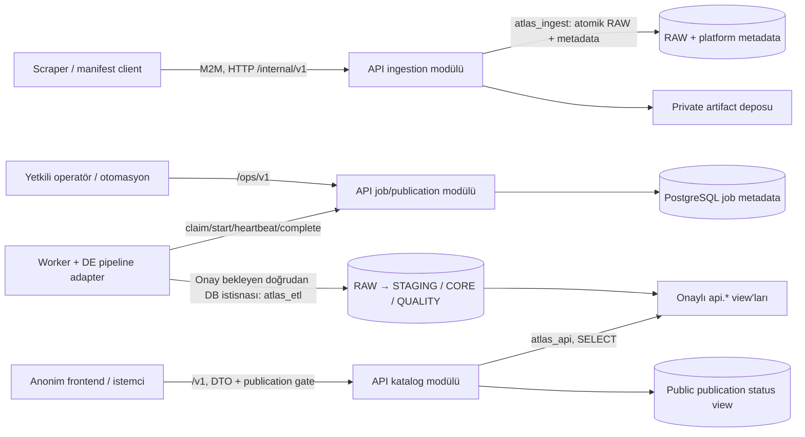

# Faz 1 — Backend/platform mimari tasarımı

**Tarih:** 13 Ekim 2026. **Durum:** Uygulama için önerilen tasarım; çalışan servis
veya uygulanmış migration değildir. Kullanıcı katalog/net okumalarının anonim
olmasını seçmiştir. Başlangıç: [Faz 0 raporu](00_CURRENT_STATE.md).

## 1. Mimari kararı ve kapsam

Python 3.13, FastAPI, Pydantic ve Psycopg 3 ile modüler bir API uygulaması;
ayrı worker süreci ve mevcut PostgreSQL 17 önerilir. Dependency sürümleri Faz 2'de
birlikte doğrulanıp lock dosyasına sabitlenecektir. İlk ortam tek API sürecidir;
Redis/Kafka/Celery/Kubernetes bağımlılığı eklenmez.

API, kimlik/scope/nesne sahipliğini kontrol eder; RAW kabulü, read DTO'ları ve
operasyon komutlarının sahibi olur. Worker, Data Engineer'ın kayıtlı pipeline
adapter'ını çalıştırır. ETL SQL/hesaplama/mapping backend'e taşınmaz.
Mevcut `load_archive.py` otomatik çağrılmayacaktır: RAW kabulü ve ETL'yi aynı
transaction'da birleştirdiği için yeni sınırı sağlamıyor.

Doğrudan DB istisnası yalnız yetkili ETL worker içindir; [ADR-0002](adr/0002-identities-and-data-access.md)
ve schema/grants önerisi owner onayı gerektirir. Scraper varsayılan olarak API'ye
veri teslim eder; frontend'e DB kimliği verilmez.

## 2. Modül ve dağıtım sınırları

| Modül | Sahip olduğu iş | Bağımlılık |
|---|---|---|
| `config` | Typed env, feature flags, secret kaynakları, boot validation | ENV/secret store |
| `auth` | Service key doğrulama, operator JWT adapter'ı, scopes, source/owner kontrolü | Phase 2 env registry; Phase 3 platform credential registry |
| `db` | Ayrı pool'lar, transaction helpers, SQL parametreleri, UTC session | Psycopg 3 / psycopg_pool |
| `ingestion` | Run yaşam döngüsü, body/hash doğrulama, atomic RAW + metadata | `atlas_ingest`, source-policy registry |
| `artifacts` | Server tarafından üretilen kimlikle private dosya saklama | Yapılandırılan disk/artifact adapter'ı |
| `catalog` | Sekiz mevcut DB view'ından allowlist DTO/query, cursor ve cache | `atlas_api`, read-model gate |
| `jobs` | Kalıcı queue/claim, lease, start/finish ve retry preview | `atlas_platform` + kayıtlı DE adapter sözleşmesi |
| `quality` | Operatöre metadata/özet görünürlüğü | Onaylı, payload içermeyen ops view |
| `operations` | Health, metrics, lineage, audit, publication preview/apply | Yetkili scopes |
| `shared` | Error formatı, request ID, limits, pagination | Diğer modüller |

API ve worker ayrı process/container olarak dağıtılır. Worker ile API aynı kaynak
paketindeki contract tiplerini kullanabilir; worker'a runtime'da API'nin DB
parolaları verilmez. Yalnız izinli `pipeline_key`/adapter sürümleri çalıştırılır;
HTTP body'den SQL, shell komutu veya import/module yolu çalıştırılmaz.

## 3. Transaction ve bağlantı politikası

| Pool / bağlantı | Hesap | İlk yerel öneri | Kullanım |
|---|---|---|---|
| Read pool | `atlas_api` | min 1 / max 5 | `api.*` + sınırlı publication metadata |
| Ingest pool | Daraltılmış `atlas_ingest` | min 1 / max 3 | RAW ve aynı transaction'daki gerekli platform tabloları |
| Control pool | Yeni `atlas_platform` | min 1 / max 2 | Auth registry, jobs, publication, ops metadata |
| Worker execution | Yeni `atlas_etl` | En çok 2; CORE için 1 dedicated bağlantı | DE'nin batch transaction'ları ve session advisory gate |

Bu rakamlar ilk ortamın konfigürasyon önerisidir, ölçülmüş kapasite hedefi değildir.
Replica sayısı × pool maksimumları + worker + maintenance rezervi, DB bağlantı
bütçesini aşamaz. `max_connections=100` değeri yükseltilmez; başlangıçta en az
20 bağlantı maintenance/diğer servisler için bütçeden ayrılır. Replica artışı ayrı
ölçüm ve ortak rate-limit politikası gerektirir.

Pool'lar lifespan sırasında açıkça açılır/doğrulanır, kapanışta boşaltılır.
Session `TimeZone=UTC`, `application_name` ve statement timeout açıkça ayarlanır.
Önerilen statement limitleri read 5s, ingest 10s, control 3s, worker 60s;
pool bekleme 1s, `idle_in_transaction_session_timeout` 15s. Query/job özellikleri
ölçümle güncellenir. Bu fazda DB ayarları değiştirilmez.

Normal istekler kısa transaction kullanır. Public liste + toplam sayım, aynı
read transaction ve shared publication gate içinde yapılır. Ingestion'da
RAW yanıtı, tüm source records, observation, idempotency sonucu ve audit aynı
`atlas_ingest` bağlantısında commit edilir; iki pool üzerinden sözde atomik
işlem yapılmaz. Auth kontrolü daha önce control pool'da yapılabilir.

Worker'ın session advisory kilidi dedicated bağlantıda tutulur; pool'a kilitli
session geri verilmez. HTTP çağrıları sırasında uzun SQL transaction tutulmaz;
DE batch'leri kısa transaction, job boyunca tutulan gate ise session kilididir.
Gateway session kapandığında kilit bırakılır; bu durum başarısız ETL'nin zaten
commit ettiği CORE verisini geri almaz.

## 4. RAW kabul ve dosya tutarlılığı

İlk kabul operasyonu bir response gövdesi ve gövdenin tüm child kayıtlarıdır;
bir dosyanın records kısmı kullanıcı tarafından parçalanıp yorumlanmaz.
Kaynak policy'si endpoint/method/source_entity ve kayıt array JSON pointer'ını
tanımlar. YÖK Atlas için bilinen beş kaynak varlığı kullanılabilir; dış kaynaklar
owner approval olmadan registry'de aktif değildir.

İstemci original, decompress edilmiş HTTP body byte'larını base64 olarak yollar.
Server byte hash'ini doğrular, UTF-8/strict JSON parse eder ve array'i policy'ye
göre çıkarır. RAW payload'ın alanları/değerleri azaltılmaz; JSONB'nin original
byte dizisini saklamadığı dikkate alınarak artifact ayrıca korunur.

Body doğrulama/hash ve artifact staging DB transaction'dan önce yapılır.
Dosya yolu yalnız server-generated artifact UUID'den üretilir. Staged artifact
atomik rename ile kalıcı olur; ardından SQL transaction tüm kayıtları yazar.
SQL başarısızlığında dosya orphan olabilir: metadata bağlantısı olmayan dosya
public okunmaz; reconciliation/owner-approved cleanup politikasıyla ele alınır.
Bu süreç dosya sistemi + SQL için distributed transaction garantisi vermez;
başarı cevabı ancak kalıcı dosya ve SQL commit tamamlanınca döner.

Hash, request identity, duplicate ve legacy davranışları
[ADR-0003](adr/0003-ingestion-identity-and-hashes.md)'te tanımlıdır. Kaynak gövdesini
yeniden indirmek, yalnız API çağrısı yaparak keyfî URL fetch etmek veya hosttan
istemci path'i okumak bu kabul yolunun parçası değildir.

## 5. Job, lease ve yayınlanabilir veri

CORE view'ları mutable ve sürümsüzdür. Yalnız `publication_id` eklemek eski bir
veri sürümünü okunabilir hale getirmez. İlk sürüm
[ADR-0004](adr/0004-jobs-and-publication-gate.md)'teki maintenance gate'i kullanır:

- `empty`: yayın yok; coverage bunu söyler, katalog veri çağrıları 503 döner.
- `ready`: doğrulanmış publication aktif; read gate altında veri sunulur.
- `updating`: yetkili worker yazıyor; yeni katalog çağrıları 503 döner.
- `awaiting_publication`: ETL başarılı, aday hazır; operator apply beklenir.
- `failed`: ETL/lease başarısız; onaylı recovery tamamlanana kadar okuma kapalıdır.

CORE yazan worker önce global exclusive session gate alır, API `start` ile state'i
`updating` yapar, sonra DE batch'lerini çalıştırır. Katalog isteği nonblocking shared
transaction gate alıp `ready` durumunu kontrol eder; count ve rows tamamlanana
kadar gate'i tutar. Bütün CORE yazarları bu adapter protokolüne uymalıdır.
Advisory lock tek başına DB erişimi olan keyfî SQL'i engellemez; worker credential'ı
bu protokolü sağlayan runner'a özel tutulması onayın ve kabul testinin şartıdır.

Worker sonucu DE'nin validation/coverage attestation'ını taşır. Backend DTO,
scope, lease ve job bağını doğrular; KPI veya semantik kalite kuralları üretmez.
Başarılı completion bir publication adayı oluşturur. Operator, dry-run planı
üzerinden mevcut job/state/epoch'a bağlı apply yapar; final transaction exclusive
gate altında current publication ve epoch'u değiştirir.

Lease süresi ilk öneri 60s, heartbeat 20s; global job deadline pipeline registry'de
belirlenir. Süresi dolmuş CORE job otomatik başka worker'a verilmez. Eski session
gate'i kapanmalı ve DE recovery planı operator tarafından onaylanmalıdır. Stale
token heartbeat/complete çağrıları reddedilir. Bu model exactly-once ETL veya
otomatik veri rollback iddiası taşımaz.

Eski publication metadata'sı audit için saklanır; tarihsel public snapshot okuması
ve metadata pointer'ını geri çevirerek rollback ilk sürümde desteklenmez. Kesintisiz
eski sürüm servisi için DE tarafından versioned/immutable read model gerekir.

## 6. Public read, caching ve görünür veri

Public uçlar anonimdir. RAW, kaynak request body'ları, credential, actor/run/job
kimlikleri ve operasyon ayrıntıları public DTO'lara konmaz. İlk DTO'lar yalnız
mevcut `api.*` alanları ve onaylı publication coverage bilgisini kapsar.

Liste/detay yıl taşır; program/net yıl eşleştirmesi yapılmaz. `NULL` korunur.
Mevcut view'da olmayan koşul/detail JSON veya doluluk/yerleşen metriği üretilmez.
BIGINT kimlik/alan/sayımları decimal string olarak serileştirilir.

Cursor, publication ID, filtre özeti, sort, son anahtar ve expiry ile HMAC imzalıdır.
Yayın değişince eski cursor 409 `SNAPSHOT_CHANGED` üretir. Public cache first-cut
60s; ETag release + query + DTO revision'a bağlıdır. Her 304 kararından önce
gate/state kontrol edilir. Gate kapalıyken 503 ve `Cache-Control: no-store`;
origin üzerindeki ETag eski veriyi geçerli ilan edemez. Daha önce cache'lenmiş
istemci verisinin bu TTL kadar eski kalabileceği frontend'e belgelenir.

## 7. Kaynak sınırları ve operasyon

Başlangıç konfigürasyonları, throughput garantisi değil savunma limitidir:
HTTP request en çok 8 MiB, decoded response 4 MiB, records en çok 1000,
JSON derinliği 64, public page size default 50 / max 100. Limit aşımında veri
kırpılmaz; anlamlı hata döner. Büyük aktarım ileride ayrı manifest/bulk adapter'ı
olarak ölçülüp onaylanır.

Rate-limit önerisi: public 120/min/IP, ingest 120/min/principal, ops 30/min/principal,
publication apply 2/min/principal. İlk tek API process'inin in-memory limiter'ı
çoklu process için global limit sayılmaz; replica öncesi gateway/shared limiter
gerekir. Reverse proxy adresleri yalnız konfigüre trusted proxy'den kabul edilir.

Structured log: request_id, operation, principal_id, approved source key,
outcome, süre ve güvenli error code. Token, cookie, DSN/parola, SQL parametreleri,
RAW body ve artifact path loglanmaz. Audit mutasyonla aynı transaction'da yazılır;
metrics labels'a keyfî run/job ID konmaz. Health cevapları ayrıntılı config içermez.

## 8. Aşama sınırı ve teslim sırası

| Aşama | Somut iş | Önkoşul |
|---|---|---|
| Faz 2 | FastAPI iskeleti, typed config, read pool, errors/request IDs, health, auth abstraction ve env registry, test zemini | Kullanıcı aşama onayı; mevcut DB korunur |
| Faz 3A | Platform metadata + ayrı servis grants/rollerinin migration'ı, migration ledger | [Metadata/rol önerisinin](04_METADATA_CHANGE_PROPOSAL.md) açık owner onayı |
| Faz 3B | RAW/artifact/idempotency uygulaması, gated public read, PostgreSQL jobs | 3A ve source-policy/DE contract kabulü |
| Faz 4 | Adapter entegrasyon, gerçekçi hacim, negatif yetki/replay/concurrency/restore | Onaylı test veri kaynağı ve DE adapter'ı |
| Faz 5 | CI, runbook ve main hedefli PR teslimi | Test/rollback kanıtları ve ayrı aşama onayı |

Faz 2'de platform metadata gerektiren iş uçları aktif değildir; çağrılırsa
`CAPABILITY_NOT_ENABLED` döner. Health/config/auth zemininin çalışması ingestion
ve ETL'nin uygulanmış olduğunu göstermez. Human OIDC provider, DE adapter ve
production host seçimi henüz harici bağımlılıktır; yapay başarılı iş sonucu
üretilerek bu eksik kapatılmaz.

Kararlar: [ADR listesi](adr/README.md), [API sözleşmesi](02_API_DESIGN.md),
[güvenlik/roller](03_SECURITY_AND_ROLES.md), [OpenAPI](openapi.yaml).
